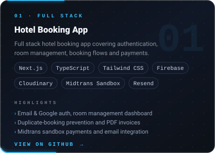
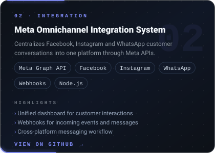
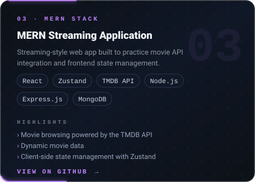
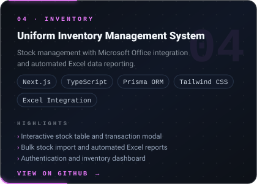

  

 

  
  
  

 

Fullstack Developer based in Jakarta. Starting from an **Automotive Engineering background at SMKN 36 Jakarta**, I transitioned my passion for troubleshooting mechanical systems into building scalable digital architectures through the **Full-Stack Web Developer Bootcamp at Harisenin.com**. Today, I build end-to-end web applications—from **Meta Omnichannel platforms** and **automated inventory systems** to **full-stack booking workflows**.

* **Interfaces** · HTML, CSS, JavaScript, TypeScript, React, Next.js, Tailwind CSS, Zustand
* **Behind them** · Node.js, Express.js, Firebase, Prisma ORM, MySQL, MongoDB, PHP & Laravel
* **Integrations** · Meta Graph API (WhatsApp, IG, FB), Midtrans Payment, Cloudinary, Resend

Have a project in mind? [Let's talk.](mailto:emailkamu@gmail.com)

 

  

 

  
<b>Full-Stack Web Developer Bootcamp</b> · Harisenin.com

   
  <blockquote>
    Intensive full-stack software engineering program focusing on modern frontend frameworks (React, Next.js), backend RESTful APIs (Node.js, Express.js), relational & NoSQL databases, version control (Git/GitHub), and real-world project deployment.
  </blockquote>

  
<b>Automotive Engineering (Teknik Otomotif)</b> · SMKN 36 Jakarta

   
  <blockquote>
    Developed strong foundations in technical diagnostics, structured problem-solving, and precision engineering—skills that naturally translated into debugging code and designing clean software architecture.
  </blockquote>

 

**Frontend Development**

  

**Backend Development**

  

**Database & Developer Tools**

  

**Currently Learning**

  

 

  
  
  
  

 

  
<b>Full feature lists</b>

   

**01. Hotel Booking App**
* Email and Google authentication
* Room management dashboard
* Room search, filtering, and sorting
* Booking workflow and duplicate booking prevention
* PDF invoice generation
* Midtrans sandbox payment integration
* Email integration

**02. Meta Omnichannel Integration System**
* Facebook, Instagram, and WhatsApp integration through Meta APIs
* Centralized customer communication management
* Cross-platform messaging workflow
* Webhook integration for incoming events and messages
* API-based communication and data handling
* Unified dashboard for monitoring customer interactions

**03. MERN Streaming Application**
* Movie browsing using the TMDB API
* Dynamic movie data
* Client-side state management
* Streaming-style user interface

**04. Uniform Inventory Management System**
* Interactive stock management table and transaction modal
* Bulk stock data import utility and automated Excel reporting
* Authentication and inventory dashboard

 

  
  

  

 

  

 

I'm interested in building useful web applications for inventory management, business workflows, and system integrations.

I'm also exploring ways to connect web applications with external platforms and services, including Microsoft Teams.

My current focus is improving application architecture, writing cleaner code, and building projects that solve practical problems.

 

- [ ] Improve full stack development skills
- [ ] Build and document practical portfolio projects
- [ ] Strengthen backend and database fundamentals
- [ ] Learn software testing and application security
- [ ] Collaborate with other developers
- [ ] Contribute to real-world software projects

 

  <b>Open to Junior Frontend Developer and Junior Full Stack Developer opportunities.</b>
  
I'm always interested in learning, collaborating, and building useful software.

  
  

 

  

